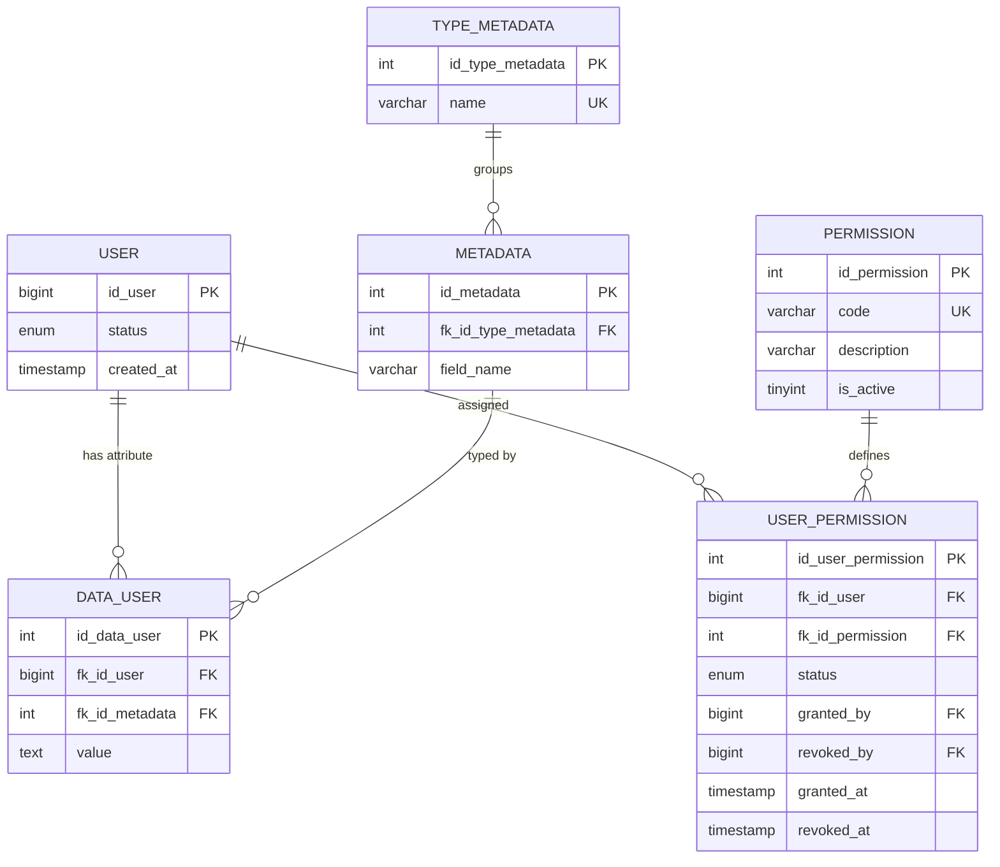
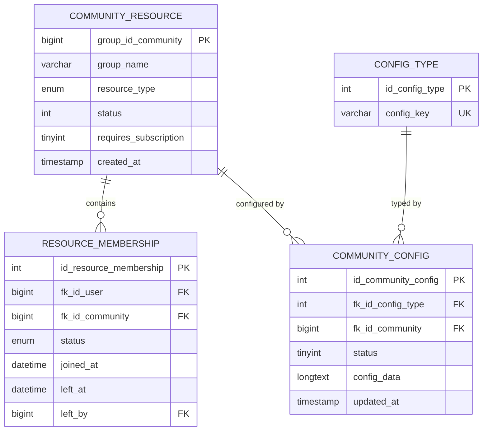
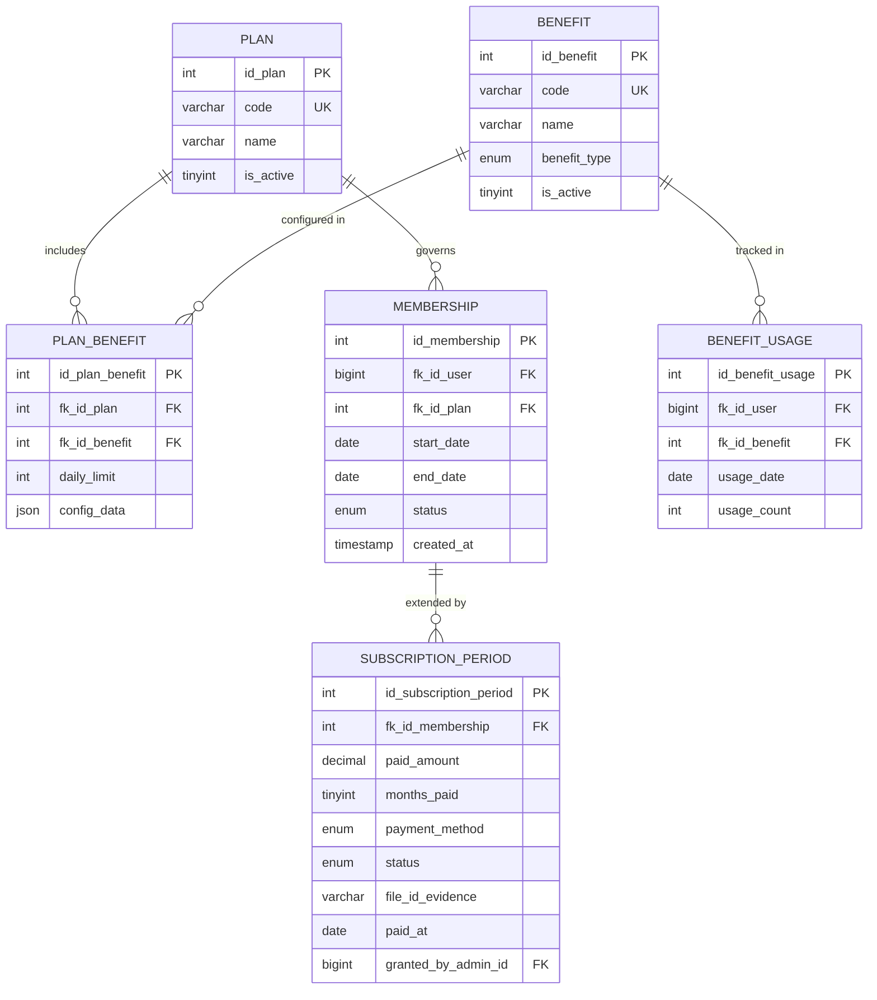
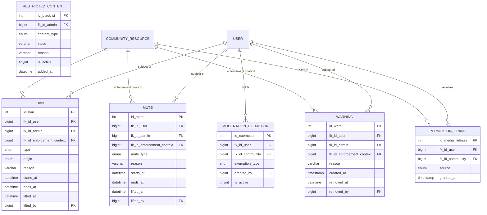
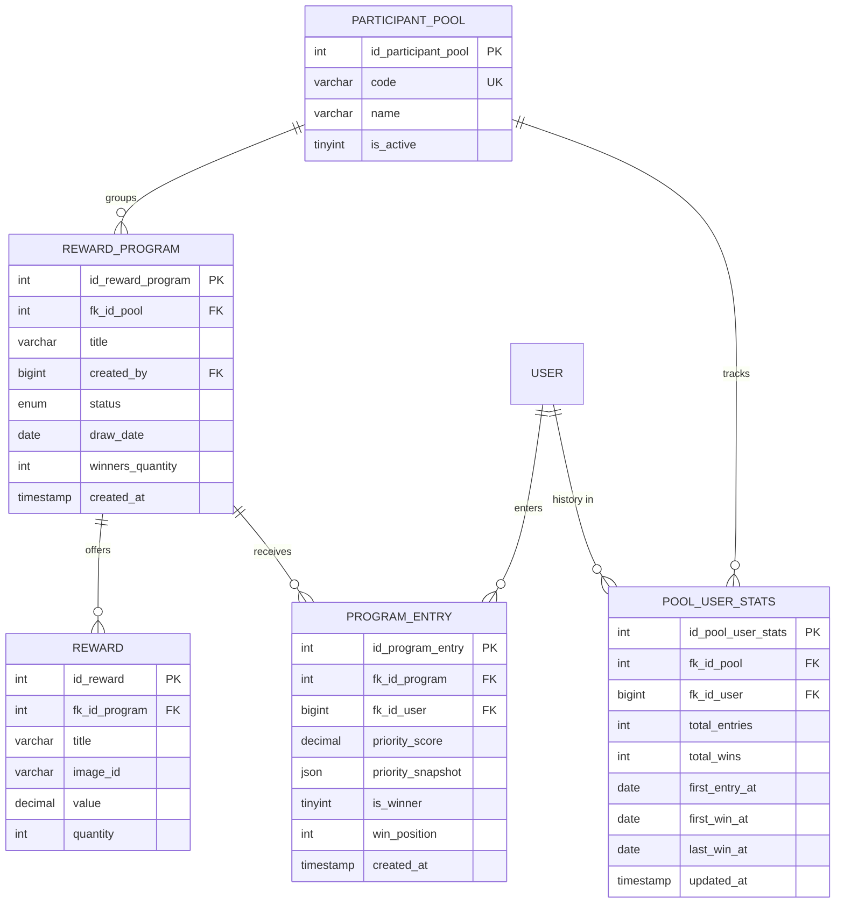
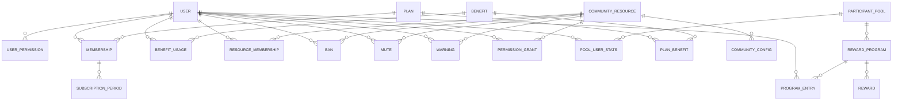

# FNBR Platform — Conceptual Relational Database Model

**Scope:** Identity · Community · Club · Moderation · Member Rewards  
**Date:** 2026-06-09  
**Status:** Implementation-ready — suitable as foundation for API design and physical database modeling

---

## Authoritative Constraints (Non-Negotiable)

These decisions govern every modeling choice in this document:

| Decision | Rule |
|---|---|
| Membership ownership | Belongs to the **user**, not to a community |
| Moderation scope | Restrictions are **global** to the user; enforcement context is recorded but does not limit scope |
| Financial structures | `tb_wallet`, `tb_wallet_bucket`, `tb_ledger`, `tb_bucket_type`, `tb_club_policy_distribution` are **legacy** — excluded from target model |
| Community configuration | JSON fields for operational config are **intentional** — no normalization required |
| Telegram-specific fields | Platform integration concerns — kept where operationally required, not promoted to domain entities |
| Permissions | Are the **source of truth** for authorization; roles simplify management only |
| Priority algorithm | Winner history **must never be reset**; participation seniority is permanent |

---

# 1. Domain-by-Domain Model

---

## 1.1 Identity

### Purpose
Provides unified user identity to every other domain. Owns users, lifecycle state, and permissions.

### Aggregate: User

**Root entity:** `User`

The user is identified by their Telegram account ID. A user exists independently of any community, subscription, or moderation record. All other domains reference users but do not own them.

**Ownership boundary:** Identity owns `User`, `UserAttribute`, `Permission`, `UserPermission`.

#### Entity: User

| Field | Type | Notes |
|---|---|---|
| `id_user` | BIGINT PK | Telegram user ID — externally assigned |
| `status` | ENUM('active','disabled','archived') | **NEW** — lifecycle state; missing from current schema |
| `created_at` | TIMESTAMP | **NEW** — missing from current schema |

**Current schema gap:** `tb_user` has only `id_user` and `fk_id_profile`. Both `status` and `created_at` are missing entirely.

#### Entity: UserAttribute (EAV — reuse existing structure)

Stores Telegram identity attributes (first_name, last_name, username) as name-value pairs.

Current tables `tb_type_metadata`, `tb_metadata`, `tb_data_user` implement this pattern correctly and should be reused without change.

#### Aggregate: Permission

**Root entity:** `Permission`

Permissions define what actions a user may perform on the platform. Roles simplify management but permissions are the authorization mechanism.

#### Entity: Permission

| Field | Type | Notes |
|---|---|---|
| `id_permission` | INT PK | Auto-increment |
| `code` | VARCHAR(50) UNIQUE | e.g., MANAGE_RAFFLES, MANAGE_MODERATION, MANAGE_CLUB |
| `description` | VARCHAR(255) | Human-readable |
| `is_active` | TINYINT | Whether this permission is still in use |
| `created_at` | TIMESTAMP | |

**New table** — does not exist in current schema.

#### Entity: UserPermission

Represents a single permission assignment. Preserves full lifecycle history.

| Field | Type | Notes |
|---|---|---|
| `id_user_permission` | INT PK | |
| `fk_id_user` | BIGINT FK → User | |
| `fk_id_permission` | INT FK → Permission | |
| `status` | ENUM('granted','active','revoked') | |
| `granted_by` | BIGINT FK → User | Who granted the permission |
| `revoked_by` | BIGINT FK → User NULL | Who revoked (NULL if still active) |
| `granted_at` | TIMESTAMP | |
| `revoked_at` | TIMESTAMP NULL | |

**New table** — does not exist in current schema.

#### Entity: Profile (transition period only)

`tb_profile` represents a simplified role concept (e.g., regular, admin, super_admin). It is kept during the migration period for backward compatibility with fortMe. It is not used for authorization decisions in new code.

### Cardinality Summary — Identity

```
User 1 ──── N UserAttribute
User 1 ──── N UserPermission N ──── 1 Permission
```

### Historical Requirements
- All permission assignments must be preserved (revoked permissions remain as records, not deleted).
- User status changes should be recorded in future iterations.

### Audit Requirements
- Who granted each permission (`granted_by`).
- When each permission was granted and revoked.
- Who revoked each permission (`revoked_by`).

---

## 1.2 Community

### Purpose
Represents the FNBR community and its official resources. Owns resource structure, classification, and membership participation records.

### Aggregate: CommunityResource

**Root entity:** `CommunityResource`

FNBR operates one community composed of multiple resources. Each resource has a type that determines its purpose and access model.

**Ownership boundary:** Community owns `CommunityResource`, `ResourceMembership`, `CommunityConfig`, `ConfigType`.

#### Entity: CommunityResource

| Field | Type | Notes |
|---|---|---|
| `group_id_community` | BIGINT PK | Telegram chat ID |
| `group_name` | VARCHAR(255) | |
| `resource_type` | ENUM('main','topic','information','support','operational','special_access') | **MIGRATE** — current ENUM('group','channel','log') is insufficient |
| `total_members` | INT | Telegram-derived operational count |
| `status` | INT | Active/inactive |
| `requires_subscription` | TINYINT | Whether Club eligibility is required for access |
| `created_at` | TIMESTAMP | |
| `updated_at` | TIMESTAMP | |

**Migration note:** `tb_community.type` ENUM must be expanded. Existing values `'group'` and `'channel'` must be mapped to the new classification during data migration. `'log'` maps to `'operational'`.

#### Entity: ResourceMembership

Tracks the full lifecycle of a user's presence in a resource. Supports multiple join/leave/remove cycles for the same user-resource pair.

| Field | Type | Notes |
|---|---|---|
| `id_resource_membership` | INT PK | |
| `fk_id_user` | BIGINT FK → User | |
| `fk_id_community` | BIGINT FK → CommunityResource | |
| `status` | ENUM('joined','left','removed') | Current state of this membership event |
| `joined_at` | DATETIME | When the user entered the resource |
| `left_at` | DATETIME NULL | When the user left or was removed |
| `left_reason` | VARCHAR(255) NULL | Reason for removal when status = 'removed' |
| `left_by` | BIGINT FK → User NULL | Admin who removed the user (NULL if self-left) |
| `welcome_message_id` | BIGINT NULL | Telegram message ID of the welcome message — integration concern |

**New table** — replaces the dual-purpose `tb_welcome`. No UNIQUE constraint on (user, resource) — the history of all join cycles must be preserved.

**Note on `tb_welcome`:** The existing `tb_welcome` uses a UNIQUE constraint on (fk_id_community, fk_user_id_user) which prevents recording re-join cycles. This table should be migrated into `tb_resource_membership` and then deprecated. Existing records represent the most recent known join event per user-resource pair.

#### Entity: CommunityConfig (reuse as-is)

`tb_community_config` and `tb_config_type` are reused without structural change. Configuration data is intentional operational JSON — no normalization is required.

### Cardinality Summary — Community

```
CommunityResource 1 ──── N ResourceMembership N ──── 1 User
CommunityResource 1 ──── N CommunityConfig N ──── 1 ConfigType
```

### Historical Requirements
- Full join/leave/remove cycles per user per resource must be preserved.
- The resource must remain in the database after deactivation — historical moderation and reward records reference it.

### Audit Requirements
- Who removed a user from a resource (`left_by`).
- Timestamp of each membership state change.

---

## 1.3 Club

### Purpose
Manages user subscriptions and subscriber benefits. Membership belongs to the user — not to any community.

### Aggregate: Membership

**Root entity:** `Membership`

A user holds at most one active membership at a time. Additional subscription periods extend the existing membership's end date rather than creating multiple active records.

**Ownership boundary:** Club owns `Membership`, `SubscriptionPeriod`, `Plan`, `PlanBenefit`, `Benefit`, `BenefitUsage`.

#### Entity: Membership

| Field | Type | Notes |
|---|---|---|
| `id_membership` | INT PK | |
| `fk_id_user` | BIGINT FK → User | Membership belongs to the user |
| `fk_id_plan` | INT FK → Plan | Active plan at time of creation or last upgrade |
| `start_date` | DATE | |
| `end_date` | DATE NULL | NULL = indefinite |
| `status` | ENUM('active','expired','canceled','suspended') | |
| `created_at` | TIMESTAMP | |

**Migrated from** `tb_subscription`. Key changes:
- Remove `fk_id_community` — membership is not community-scoped.
- Add `fk_id_plan` — links membership to its plan.

**Migration note:** Existing `tb_subscription` records do not have a `plan_id`. During migration, the plan must be inferred from operational context or set to a default. The `fk_id_community` column is dropped — its data provides no business value in the target model.

#### Entity: SubscriptionPeriod

Each period represents a single subscription grant event that contributed to the membership duration.

| Field | Type | Notes |
|---|---|---|
| `id_subscription_period` | INT PK | |
| `fk_id_membership` | INT FK → Membership | |
| `paid_amount` | DECIMAL(10,2) | Amount paid for this period |
| `months_paid` | TINYINT | Duration contribution |
| `payment_method` | ENUM('PIX','GIFT','MANUAL') | |
| `status` | ENUM('PENDING','PAID','FAILED','REFUNDED','CANCELED') | |
| `file_id_evidence` | VARCHAR(255) | Telegram file ID of payment proof — **must never be deleted** |
| `paid_at` | DATE NULL | |
| `granted_by_admin_id` | BIGINT FK → User NULL | Admin who granted a MANUAL period |
| `created_at` | TIMESTAMP | |

**Migrated from** `tb_subscription_payment`. Key changes:
- Rename `fk_id_subscription` → `fk_id_membership`.
- Rename `file_id_subscription` → `file_id_evidence` for semantic clarity.
- Add `granted_by_admin_id` for audit of manual grants.

#### Aggregate: Plan

**Root entity:** `Plan`

Plans define which benefits a subscriber receives. Plans are configurable and evolve over time.

#### Entity: Plan

| Field | Type | Notes |
|---|---|---|
| `id_plan` | INT PK | |
| `code` | VARCHAR(10) UNIQUE | e.g., PLAN_3, PLAN_4, PLAN_5 |
| `name` | VARCHAR(100) | Display name |
| `description` | TEXT NULL | |
| `is_active` | TINYINT | Whether new subscriptions may use this plan |
| `created_at` | TIMESTAMP | |

**New table** — does not exist in current schema.

#### Entity: Benefit

| Field | Type | Notes |
|---|---|---|
| `id_benefit` | INT PK | |
| `code` | VARCHAR(50) UNIQUE | e.g., DAILY_PIN, CONTENT_PROMOTION, EXCLUSIVE_ACCESS |
| `name` | VARCHAR(100) | |
| `description` | TEXT NULL | |
| `benefit_type` | ENUM('access','daily_limited','unlimited') | Determines whether usage tracking is required |
| `is_active` | TINYINT | |
| `created_at` | TIMESTAMP | |

**New table** — does not exist in current schema.

#### Entity: PlanBenefit

Configures the value of a benefit within a specific plan.

| Field | Type | Notes |
|---|---|---|
| `id_plan_benefit` | INT PK | |
| `fk_id_plan` | INT FK → Plan | |
| `fk_id_benefit` | INT FK → Benefit | |
| `daily_limit` | INT NULL | NULL = unlimited; value = max uses per day |
| `config_data` | JSON NULL | Extensible configuration for future benefit types |
| `created_at` | TIMESTAMP | |

**New table** — does not exist in current schema.

#### Entity: BenefitUsage

Tracks daily consumption of limited benefits per user.

| Field | Type | Notes |
|---|---|---|
| `id_benefit_usage` | INT PK | |
| `fk_id_user` | BIGINT FK → User | |
| `fk_id_benefit` | INT FK → Benefit | |
| `usage_date` | DATE | The calendar day of consumption |
| `usage_count` | INT NOT NULL DEFAULT 0 | Number of uses on this date |
| `updated_at` | TIMESTAMP ON UPDATE | |

UNIQUE constraint on (`fk_id_user`, `fk_id_benefit`, `usage_date`).

**New table** — does not exist in current schema.

### Cardinality Summary — Club

```
User 1 ──── N Membership N ──── 1 Plan
Membership 1 ──── N SubscriptionPeriod
Plan 1 ──── N PlanBenefit N ──── 1 Benefit
User 1 ──── N BenefitUsage N ──── 1 Benefit
```

### Historical Requirements
- All membership records must be preserved (including expired and canceled).
- All subscription periods must be preserved — the `file_id_evidence` chain must never be broken.
- Plan records must remain after deactivation — historical memberships reference them.

### Audit Requirements
- Which admin granted a MANUAL subscription period (`granted_by_admin_id`).
- Original payment amount, method, and date per period.
- Evidence file ID linking each grant to its payment proof.

---

## 1.4 Moderation

### Purpose
Enforces community policies and manages member restrictions globally. Restrictions are global to the user. Community references in moderation records represent enforcement context, not restriction scope.

### Aggregate: Ban

**Root entity:** `Ban`

A ban removes a user from the community. A banned user must not be allowed to participate in any managed resource. Bans are a global state — the community reference records where the ban was applied.

#### Entity: Ban

| Field | Type | Notes |
|---|---|---|
| `id_ban` | INT PK | |
| `fk_id_user` | BIGINT FK → User | The banned user |
| `fk_id_admin` | BIGINT FK → User | Who applied the ban |
| `fk_id_enforcement_context` | BIGINT FK → CommunityResource | The resource where the ban was triggered — **audit context, not scope** |
| `type` | ENUM('temporary','permanent') | |
| `origin` | ENUM('autodetect','welcome','command') | **MIGRATE** — current column has typos: 'autodetectt', 'welcomet' |
| `reason` | VARCHAR(255) | |
| `starts_at` | DATETIME | |
| `ends_at` | DATETIME NULL | NULL = permanent |
| `lifted_at` | DATETIME NULL | **NEW** — when the ban was lifted |
| `lifted_by` | BIGINT FK → User NULL | **NEW** — who lifted the ban |

**Migrated from** `tb_ban`. Key changes:
- Fix `applied_by` ENUM: `'autodetectt'` → `'autodetect'`, `'welcomet'` → `'welcome'`.
- Rename column `applied_by` → `origin` for semantic clarity.
- Rename `applied_by_admin_ban` → `fk_id_admin`.
- Rename `banned_id_user` → `fk_id_user`.
- Rename `fk_id_community` → `fk_id_enforcement_context` to make its role explicit.
- Add `lifted_at`, `lifted_by` for complete ban lifecycle recording.

**Migration note for ENUM typos:** Historical records store `'autodetectt'` and `'welcomet'`. These values must be corrected in-place during migration. The correct values are `'autodetect'` and `'welcome'`.

### Aggregate: Mute

#### Entity: Mute

| Field | Type | Notes |
|---|---|---|
| `id_mute` | INT PK | |
| `fk_id_user` | BIGINT FK → User | |
| `fk_id_admin` | BIGINT FK → User | |
| `fk_id_enforcement_context` | BIGINT FK → CommunityResource | Enforcement context, not scope |
| `mute_type` | ENUM('temporary','indefinite') | **NEW** — missing from current schema |
| `reason` | VARCHAR(255) | |
| `starts_at` | DATETIME | |
| `ends_at` | DATETIME NULL | NULL = indefinite |
| `lifted_at` | DATETIME NULL | **NEW** |
| `lifted_by` | BIGINT FK → User NULL | **NEW** |

**Migrated from** `tb_mute`. Key changes:
- Add `mute_type`.
- Add `lifted_at`, `lifted_by`.
- Rename FKs for consistency.
- Rename `fk_id_community` → `fk_id_enforcement_context`.

### Aggregate: Warning

Warnings accumulate at the community level and do not expire automatically. They are removed explicitly by an administrator.

#### Entity: Warning

| Field | Type | Notes |
|---|---|---|
| `id_warn` | INT PK | |
| `fk_id_user` | BIGINT FK → User | |
| `fk_id_admin` | BIGINT FK → User | |
| `fk_id_enforcement_context` | BIGINT FK → CommunityResource | |
| `reason` | VARCHAR(255) | |
| `created_at` | TIMESTAMP | |
| `removed_at` | DATETIME NULL | **NEW** — when the warning was removed |
| `removed_by` | BIGINT FK → User NULL | **NEW** — who removed it |

**Migrated from** `tb_warn`. Key changes:
- Add `removed_at`, `removed_by` — currently the schema has no mechanism to record warning removal.
- Rename `fk_id_community` → `fk_id_enforcement_context`.

### Aggregate: RestrictedContent

Defines content prohibited within the community. Enforcement is automatic.

#### Entity: RestrictedContent

| Field | Type | Notes |
|---|---|---|
| `id_blacklist` | INT PK | |
| `fk_id_admin` | BIGINT FK → User | Who added the entry |
| `content_type` | ENUM('url','domain','invite_link','text','user_id') | **NEW** — currently missing; all content types are mixed in a single untyped `value` column |
| `value` | VARCHAR(255) | The restricted content pattern |
| `reason` | VARCHAR(255) NULL | |
| `is_active` | TINYINT | |
| `added_at` | DATETIME | |
| `updated_at` | TIMESTAMP ON UPDATE | **NEW** |

**Migrated from** `tb_blacklist`. Key change: add `content_type` discriminator — the current schema mixes URLs, domains, invite links, and user IDs in a single column with no way to distinguish them programmatically.

### Aggregate: PermissionGrant

Records when and how a user received media/participation permissions in a resource. This is an enforcement audit log, not an authorization decision store.

#### Entity: PermissionGrant (reuse as-is)

`tb_media_release` is reused without structural change. It correctly records the source of a permission grant event (join_rules/command/manual/admin).

### Aggregate: ModerationExemption

Some users or systems may be exempt from specific moderation policies (e.g., exempt from content cleanup, exempt from automated moderation rules). Exemptions do not override community sanctions (bans, mutes, warnings remain active).

#### Entity: ModerationExemption

| Field | Type | Notes |
|---|---|---|
| `id_exemption` | INT PK | |
| `fk_id_user` | BIGINT FK → User | The exempt user |
| `fk_id_community` | BIGINT FK → CommunityResource NULL | NULL = all resources |
| `exemption_type` | ENUM('content_cleanup','auto_moderation','access_restriction') | Which policy is bypassed |
| `granted_by` | BIGINT FK → User | |
| `granted_at` | TIMESTAMP | |
| `is_active` | TINYINT | |

**New table** — does not exist in current schema. Captures the documented exemption concept.

#### Other Moderation Structures (reuse as-is)

| Table | Classification | Notes |
|---|---|---|
| `tb_gifs` | Reuse | GIF content lifecycle policy enforcement |
| `tb_community_config` + `tb_config_type` | Reuse | Welcome policies, night mode, automated rules — intentional operational JSON |

### Cardinality Summary — Moderation

```
User 1 ──── N Ban
User 1 ──── N Mute
User 1 ──── N Warning
User 1 ──── N PermissionGrant
CommunityResource ──── N Ban          (enforcement context)
CommunityResource ──── N Mute         (enforcement context)
CommunityResource ──── N Warning      (enforcement context)
CommunityResource ──── N PermissionGrant
RestrictedContent (standalone — no user FK on record, only on created_by)
User 1 ──── N ModerationExemption
```

### Historical Requirements
- All ban, mute, and warning records must never be deleted.
- Lifted bans and mutes must preserve the original record with `lifted_at`/`lifted_by` appended.
- Removed warnings must preserve the original record with `removed_at`/`removed_by` appended.
- All blacklist entries, including inactive ones, must be preserved.

### Audit Requirements
- Who applied each restriction, when, in which resource context, and why.
- Who lifted/removed each restriction, and when.
- Origin of each restriction (autodetect / welcome / command).
- Source of every permission grant (join_rules / command / manual / admin).

---

## 1.5 Member Rewards

### Purpose
Manages reward programs, participant eligibility, and fair reward distribution. Uses a priority algorithm rather than random selection. Winner history is permanent and never reset.

### Aggregate: ParticipantPool

**Root entity:** `ParticipantPool`

A participant pool is the shared context across multiple reward programs. Programs that belong to the same pool share winner history and priority rankings. This is the central concept that `tb_raffle_user_stats.fk_id_community` was approximating — but community is the wrong scope owner.

#### Entity: ParticipantPool

| Field | Type | Notes |
|---|---|---|
| `id_participant_pool` | INT PK | |
| `code` | VARCHAR(50) UNIQUE | e.g., CLUB, LEGO, STW |
| `name` | VARCHAR(100) | |
| `description` | TEXT NULL | |
| `is_active` | TINYINT | |
| `created_at` | TIMESTAMP | |

**New table** — does not exist in current schema.

### Aggregate: RewardProgram

**Root entity:** `RewardProgram`

A reward program is a specific distribution event. Programs belong to a pool. Programs do not belong to a community — the community provides operational context but does not own the program.

#### Entity: RewardProgram

| Field | Type | Notes |
|---|---|---|
| `id_reward_program` | INT PK | |
| `fk_id_pool` | INT FK → ParticipantPool | The pool this program belongs to |
| `title` | VARCHAR(255) | **NEW** — missing from current `tb_raffle` |
| `description` | TEXT NULL | **NEW** |
| `created_by` | BIGINT FK → User | Admin who created the program |
| `status` | ENUM('DRAFT','OPEN','CLOSED','DRAWN','CANCELED','ARCHIVED') | ARCHIVED added — missing from current schema |
| `draw_date` | DATE | |
| `winners_quantity` | INT | |
| `created_at` | TIMESTAMP | |

**Migrated from** `tb_raffle`. Key changes:
- Replace `fk_id_community` with `fk_id_pool`.
- Add `title` and `description`.
- Add `ARCHIVED` to the status ENUM.

**Migration note:** Existing `tb_raffle` records have `fk_id_community`. During migration, the community reference must be used to determine which pool the program belongs to, and `fk_id_pool` must be set accordingly. After migration `fk_id_community` is removed from this table.

#### Entity: Reward

Describes what is distributed through a program. Separated from the program to support multiple distinct prizes per program.

| Field | Type | Notes |
|---|---|---|
| `id_reward` | INT PK | |
| `fk_id_program` | INT FK → RewardProgram | |
| `title` | VARCHAR(255) | |
| `description` | TEXT NULL | |
| `image_id` | VARCHAR(255) NULL | Telegram file ID — integration concern |
| `value` | DECIMAL(10,2) NULL | Monetary or notional value |
| `quantity` | INT NOT NULL DEFAULT 1 | |
| `created_at` | TIMESTAMP | |

**New table** — replaces the EAV pattern of `tb_raffle_metadata`. Reward attributes that were previously stored as generic metadata entries are now first-class fields.

### Aggregate: ProgramEntry

**Root entity:** `ProgramEntry`

One entry per user per program. Participation is voluntary. Records the winner outcome and the priority snapshot used at draw time for audit reproducibility.

#### Entity: ProgramEntry

| Field | Type | Notes |
|---|---|---|
| `id_program_entry` | INT PK | |
| `fk_id_program` | INT FK → RewardProgram | |
| `fk_id_user` | BIGINT FK → User | |
| `priority_score` | DECIMAL(10,4) NULL | Calculated priority at draw time — audit of distribution order |
| `priority_snapshot` | JSON NULL | **NEW** — snapshot of the 4 priority factors at draw time (wins, seniority, last_win, tiebreak) — enables result reproducibility |
| `is_winner` | TINYINT DEFAULT 0 | |
| `win_position` | INT NULL | Rank among winners |
| `created_at` | TIMESTAMP | Participation seniority reference |

UNIQUE constraint on (`fk_id_program`, `fk_id_user`).

**Migrated from** `tb_raffle_entry`. Key changes:
- Rename `base_weight` → `priority_score` (semantic clarification).
- Replace `final_weight` with `priority_snapshot` JSON (richer audit trail).
- All existing `is_winner` and `win_position` values must be preserved exactly.

### Aggregate: PoolUserStats

**Root entity:** `PoolUserStats`

The persistent fairness state for a participant within a pool. Contains the four inputs to the priority algorithm. This aggregate is the most critical data to preserve during migration — corruption means the priority model produces incorrect results.

#### Entity: PoolUserStats

| Field | Type | Notes |
|---|---|---|
| `id_pool_user_stats` | INT PK | |
| `fk_id_pool` | INT FK → ParticipantPool | Pool scope — **NOT community scope** |
| `fk_id_user` | BIGINT FK → User | |
| `total_entries` | INT DEFAULT 0 | Priority factor 2: participation seniority proxy |
| `total_wins` | INT DEFAULT 0 | Priority factor 1: fewer wins = higher priority |
| `first_entry_at` | DATE NULL | **NEW** — seniority anchor; derivable from first program_entry but stored for performance |
| `first_win_at` | DATE NULL | Historical record |
| `last_win_at` | DATE NULL | Priority factor 3: longer since last win = higher priority |
| `created_at` | TIMESTAMP | |
| `updated_at` | TIMESTAMP ON UPDATE | |

UNIQUE constraint on (`fk_id_pool`, `fk_id_user`).

**Migrated from** `tb_raffle_user_stats`. Key change: replace `fk_id_community` with `fk_id_pool`. All four historical values (`total_entries`, `total_wins`, `first_win_at`, `last_win_at`) must be migrated with exact precision.

### Cardinality Summary — Member Rewards

```
ParticipantPool 1 ──── N RewardProgram
RewardProgram 1 ──── N Reward
RewardProgram 1 ──── N ProgramEntry N ──── 1 User
ParticipantPool 1 ──── N PoolUserStats N ──── 1 User
```

### Historical Requirements
- All program entries must be preserved — participation history is permanent.
- All winner records must be preserved — winner history must never be reset.
- `PoolUserStats` must be migrated with exact values — the four fairness fields are irreplaceable.
- Completed and archived programs must remain accessible for audit.

### Audit Requirements
- Who created each program.
- What were the priority scores at draw time (enables result reproducibility).
- Full `priority_snapshot` per entry at draw time.
- Draw date and distribution date.

---

# 2. Cross-Domain Relationships

Domains are connected through integration contracts. Foreign keys cross domain boundaries only as references — ownership does not transfer.

## Integration Contract Map

```
           ┌──────────────────────────────────────────────────────────────────┐
           │                        IDENTITY                                  │
           │  User · UserAttribute · Permission · UserPermission              │
           └──────────────────────────────────────────────────────────────────┘
                │              │               │               │
         user_id ref     user_id ref      user_id ref     user_id ref
                │              │               │               │
                ▼              ▼               ▼               ▼
          COMMUNITY          CLUB          MODERATION    MEMBER REWARDS
```

## Contract: Community Admission
**Decision owner:** Community  
**Consumed information:**
- Identity → user identity, user status (active/disabled/archived)
- Club → membership eligibility (is user an active subscriber?)
- Moderation → restriction status (is user banned or muted?)

Community decides: allow / deny / apply conditions.

## Contract: Membership Eligibility
**Decision owner:** Club  
**Consumed information:**
- Identity → user identity
Club decides: eligible / not eligible. Membership is user-owned. No community involvement.

## Contract: Restriction Status
**Decision owner:** Moderation  
**Consumed information:**
- Identity → user identity
- Community → resource context (what resource is the user trying to access?)
Moderation decides: restriction exists / restriction type / restriction state.
Restrictions are global — the resource context is for enforcement and audit, not for scope.

## Contract: Reward Eligibility
**Decision owner:** Member Rewards  
**Consumed information:**
- Identity → user identity
- Club → is user an active subscriber? (for subscriber-only programs)
- Moderation → is user banned? (ban may disqualify from participation)
Member Rewards decides: eligible / not eligible to participate.

## Cross-Domain Foreign Key Summary

| FK | From | To | Relationship type |
|---|---|---|---|
| `fk_id_user` | All domain tables | `tb_user` | Reference — Identity is the authority |
| `fk_id_enforcement_context` | Ban, Mute, Warning | `tb_community` | Reference — Community provides context only |
| `fk_id_community` | PermissionGrant | `tb_community` | Reference — Community provides context only |
| `fk_id_pool` | RewardProgram, PoolUserStats | `tb_participant_pool` | Owned — Rewards internal |
| `fk_id_membership` | SubscriptionPeriod | `tb_membership` | Owned — Club internal |
| `fk_id_plan` | Membership | `tb_plan` | Owned — Club internal |

---

# 3. Migration Strategy

## Classification Table

| Table | Strategy | Reason |
|---|---|---|
| `tb_user` | **Migrate** | Add `status` ENUM, add `created_at` — missing lifecycle fields |
| `tb_profile` | **Retain during transition** | Backward compat with fortMe; superseded by UserPermission for new code |
| `tb_type_metadata` | **Reuse** | EAV type registry — correct as-is |
| `tb_metadata` | **Reuse** | EAV field definitions — correct as-is |
| `tb_data_user` | **Reuse** | EAV user attributes — correct as-is |
| `tb_community` | **Migrate** | Expand `type` ENUM to match domain resource classification |
| `tb_community_config` | **Reuse** | Intentional operational JSON — no change required |
| `tb_config_type` | **Reuse** | Config type registry — no change required |
| `tb_welcome` | **Deprecate** | Data migrated to `tb_resource_membership`; Telegram message tracking absorbed into that table |
| `tb_ban` | **Migrate** | Fix ENUM typos; rename columns; add `lifted_at`/`lifted_by`; rename `fk_id_community` → `fk_id_enforcement_context` |
| `tb_mute` | **Migrate** | Add `mute_type`; add `lifted_at`/`lifted_by`; rename context FK |
| `tb_warn` | **Migrate** | Add `removed_at`/`removed_by`; rename context FK |
| `tb_blacklist` | **Migrate** | Add `content_type` discriminator; add `updated_at` |
| `tb_media_release` | **Reuse** | Permission grant audit log — correct as-is |
| `tb_gifs` | **Reuse** | GIF content lifecycle tracking — correct as-is |
| `tb_extra` | **Reuse** | Operational keyword store — correct as-is |
| `tb_subscription` | **Migrate** | Remove `fk_id_community`; add `fk_id_plan`; rename to `tb_membership` |
| `tb_subscription_payment` | **Migrate** | Rename to `tb_subscription_period`; rename `file_id_subscription` → `file_id_evidence`; add `granted_by_admin_id`; rename FK |
| `tb_raffle` | **Migrate** | Replace `fk_id_community` with `fk_id_pool`; add `title`/`description`; add ARCHIVED to status; rename to `tb_reward_program` |
| `tb_raffle_entry` | **Migrate** | Rename `base_weight` → `priority_score`; replace `final_weight` with `priority_snapshot` JSON; rename to `tb_program_entry` |
| `tb_raffle_user_stats` | **Migrate** | Replace `fk_id_community` with `fk_id_pool`; add `first_entry_at`; rename to `tb_pool_user_stats` |
| `tb_raffle_metadata` | **Deprecate** | Replaced by direct fields on `tb_reward`; existing data must be extracted and inserted into `tb_reward` before this table is removed |
| `tb_broadcast_history` | **Reuse** | Platform operations log — correct as-is (out of current scope) |
| `tb_bot_groups` | **Reuse** | Gamification integration (fortMe) — out of current scope |
| `fortme_duels` | **Bug fix** | Rename to `tb_fortme_duels` — active bug; code expects `tb_fortme_duels`, schema defines `fortme_duels` |
| `tb_duel_moves` | **Reuse** | Gamification (fortMe) — out of current scope |
| `tb_fortme_features` | **Reuse** | Gamification — out of current scope |
| `tb_fortme_contents` | **Reuse** | 176+ content entries — must not be touched |
| `tb_fortme_daily_usage` | **Reuse** | Gamification — out of current scope |
| `tb_fortme_votes` | **Reuse** | Gamification — out of current scope |
| `tb_fortme_user_stats` | **Reuse** | Gamification — out of current scope |
| `tb_support` | **Retain** | Support domain — out of current scope; do not modify |
| `tb_type_ticket` | **Retain** | Support domain — out of current scope |
| `tb_chat_link` | **Retain** | Support domain — out of current scope |
| `tb_wallet` | **Deprecate** | Legacy financial experiment — not part of target architecture |
| `tb_wallet_bucket` | **Deprecate** | Legacy financial experiment |
| `tb_ledger` | **Archive then Deprecate** | Financial audit trail — data must be archived to cold storage before removal; do not delete records |
| `tb_bucket_type` | **Deprecate** | Legacy financial experiment |
| `tb_club_policy` | **Deprecate** | Legacy financial experiment |
| `tb_club_policy_distribution` | **Deprecate** | Legacy financial experiment |
| `tb_partner` | **Deprecate** | Discontinued program — data may be archived |
| `tb_partner_post` | **Deprecate** | Discontinued program |
| `tb_source_partner` | **Deprecate** | Discontinued program |

---

# 4. Historical Data Preservation

The following data must survive migration without loss or corruption.

## 4.1 Moderation History

| Data | Source | Migration Action |
|---|---|---|
| All ban records | `tb_ban` | Migrate to new `tb_ban`; fix ENUM typos in-place before migration; preserve all original values |
| All mute records | `tb_mute` | Migrate; existing `ends_at = NULL` records map to `mute_type = 'indefinite'` |
| All warning records | `tb_warn` | Migrate; `removed_at` and `removed_by` start as NULL for all existing records |
| All blacklist entries | `tb_blacklist` | Migrate; `content_type` must be inferred from the `value` field format during migration |
| All permission grant events | `tb_media_release` | Reuse — no migration required |

**Critical:** Moderation records are legal/operational history. They may not be truncated, reset, or selectively migrated.

## 4.2 Subscription / Membership History

| Data | Source | Migration Action |
|---|---|---|
| All membership records | `tb_subscription` | Migrate to `tb_membership`; `fk_id_community` dropped; `fk_id_plan` must be populated (default plan assignment acceptable if plan is unknown) |
| All subscription periods | `tb_subscription_payment` | Migrate to `tb_subscription_period`; `file_id_subscription` → `file_id_evidence` (value copied exactly) |

**Critical:** `file_id_evidence` values are Telegram file IDs. These cannot be regenerated. If lost, the link between a membership grant and its payment proof is permanently severed.

## 4.3 Reward / Raffle History

| Data | Source | Migration Action |
|---|---|---|
| All program records | `tb_raffle` | Migrate to `tb_reward_program`; `fk_id_community` used to resolve `fk_id_pool` then dropped |
| All entry records | `tb_raffle_entry` | Migrate to `tb_program_entry`; `is_winner` and `win_position` must be preserved exactly |
| All fairness state | `tb_raffle_user_stats` | Migrate to `tb_pool_user_stats`; `fk_id_community` used to resolve `fk_id_pool` then dropped; all four history fields must be copied with exact values |
| Reward metadata | `tb_raffle_metadata` | Extract and insert into `tb_reward` before deprecating; title/description/image_id fields populated from EAV values |

**Critical:** `tb_raffle_user_stats.total_wins`, `total_entries`, `first_win_at`, `last_win_at` are the four inputs to the priority algorithm. Any corruption or truncation means future draws produce incorrect priority rankings. This is the highest-risk migration in the entire model.

## 4.4 Financial Audit Data

| Data | Source | Migration Action |
|---|---|---|
| Ledger entries | `tb_ledger` | Archive to a separate read-only table or cold storage before `tb_ledger` is removed. Do NOT delete. |

Ledger data represents financial audit history and may be needed for future regulatory or operational review even though the wallet system is deprecated.

## 4.5 Participation History

| Data | Source | Migration Action |
|---|---|---|
| Resource join events | `tb_welcome` | Migrate to `tb_resource_membership`; each existing record becomes a row with `status = 'joined'`, `welcome_message_id` preserved |

The UNIQUE constraint on `tb_welcome` means it only recorded the most recent join per user-resource pair. After migration, this limitation is removed — future events will record full cycles.

---

# 5. Audit Requirements

Audit capability means: who did what, when, and in what context. Every state change that has operational consequences must be traceable.

## Identity

| Event | Required Fields |
|---|---|
| Permission granted | `granted_by`, `granted_at` |
| Permission revoked | `revoked_by`, `revoked_at` |
| User status change | (future: user status history table) |

## Community

| Event | Required Fields |
|---|---|
| User removed from resource | `left_by` (admin), `left_at`, `left_reason` |
| Resource created | `created_at` |
| Resource configuration changed | Currently not tracked — config changes overwrite; future: config history |

## Club

| Event | Required Fields |
|---|---|
| Subscription period granted (MANUAL) | `granted_by_admin_id`, `created_at`, `payment_method = 'MANUAL'` |
| Subscription period paid (PIX/GIFT) | `file_id_evidence`, `paid_at`, `paid_amount` |
| Membership created | `created_at`, `fk_id_plan` |

## Moderation

| Event | Required Fields |
|---|---|
| Ban applied | `fk_id_admin`, `starts_at`, `origin`, `fk_id_enforcement_context`, `reason` |
| Ban lifted | `lifted_by`, `lifted_at` |
| Mute applied | `fk_id_admin`, `starts_at`, `mute_type`, `fk_id_enforcement_context`, `reason` |
| Mute lifted | `lifted_by`, `lifted_at` |
| Warning applied | `fk_id_admin`, `created_at`, `fk_id_enforcement_context`, `reason` |
| Warning removed | `removed_by`, `removed_at` |
| Blacklist entry added | `fk_id_admin`, `added_at`, `content_type` |
| Blacklist entry deactivated | tracked via `is_active` + `updated_at` |
| Permission granted to user | `source`, `granted_at` (via `tb_media_release`) |

## Member Rewards

| Event | Required Fields |
|---|---|
| Program created | `created_by`, `created_at`, `fk_id_pool`, `winners_quantity` |
| User entered program | `created_at` (participation seniority reference) |
| Draw executed | `priority_score` + `priority_snapshot` per entry, `is_winner`, `win_position` |
| Program status change | status ENUM transitions (DRAFT → OPEN → CLOSED → DRAWN) |

---

# 6. Final Conceptual Database Model

## 6.1 Entity and Ownership Summary

| Domain | Owns | Table |
|---|---|---|
| Identity | User | `tb_user` |
| Identity | UserAttribute | `tb_data_user`, `tb_metadata`, `tb_type_metadata` |
| Identity | Permission | `tb_permission` (new) |
| Identity | UserPermission | `tb_user_permission` (new) |
| Community | CommunityResource | `tb_community` |
| Community | ResourceMembership | `tb_resource_membership` (new) |
| Community | CommunityConfig | `tb_community_config`, `tb_config_type` |
| Club | Membership | `tb_membership` (from tb_subscription) |
| Club | SubscriptionPeriod | `tb_subscription_period` (from tb_subscription_payment) |
| Club | Plan | `tb_plan` (new) |
| Club | PlanBenefit | `tb_plan_benefit` (new) |
| Club | Benefit | `tb_benefit` (new) |
| Club | BenefitUsage | `tb_benefit_usage` (new) |
| Moderation | Ban | `tb_ban` |
| Moderation | Mute | `tb_mute` |
| Moderation | Warning | `tb_warn` |
| Moderation | RestrictedContent | `tb_blacklist` |
| Moderation | PermissionGrant | `tb_media_release` |
| Moderation | ModerationExemption | `tb_moderation_exemption` (new) |
| Moderation | ContentLifecycle | `tb_gifs` |
| Member Rewards | ParticipantPool | `tb_participant_pool` (new) |
| Member Rewards | RewardProgram | `tb_reward_program` (from tb_raffle) |
| Member Rewards | Reward | `tb_reward` (new) |
| Member Rewards | ProgramEntry | `tb_program_entry` (from tb_raffle_entry) |
| Member Rewards | PoolUserStats | `tb_pool_user_stats` (from tb_raffle_user_stats) |
| Platform/Ops | BroadcastHistory | `tb_broadcast_history` |
| Platform/Ops | OperationalStore | `tb_extra` |
| Gamification | (out of scope) | `tb_fortme_*`, `fortme_duels`, `tb_bot_groups` |
| Support | (out of scope) | `tb_support`, `tb_type_ticket`, `tb_chat_link` |

## 6.2 Domain Diagrams

### Identity Domain



### Community Domain



### Club Domain



### Moderation Domain



### Member Rewards Domain



## 6.3 Complete Cross-Domain Relationship Diagram



## 6.4 New Tables Required

| Table | Domain | Replaces / Rationale |
|---|---|---|
| `tb_permission` | Identity | No permission catalog exists |
| `tb_user_permission` | Identity | No granular permission assignment exists |
| `tb_resource_membership` | Community | Replaces `tb_welcome` (adds full lifecycle history) |
| `tb_plan` | Club | No plan registry exists |
| `tb_benefit` | Club | No benefit catalog exists |
| `tb_plan_benefit` | Club | No benefit configuration per plan exists |
| `tb_benefit_usage` | Club | No daily benefit consumption tracking exists |
| `tb_moderation_exemption` | Moderation | Exemption concept documented but no table exists |
| `tb_participant_pool` | Member Rewards | Missing root concept — pools are not currently modeled |
| `tb_reward` | Member Rewards | Replaces EAV approach of `tb_raffle_metadata` |

## 6.5 Tables to Deprecate

| Table | Reason |
|---|---|
| `tb_wallet` | Legacy financial experiment |
| `tb_wallet_bucket` | Legacy financial experiment |
| `tb_ledger` | Legacy financial experiment — archive data first |
| `tb_bucket_type` | Legacy financial experiment |
| `tb_club_policy` | Legacy financial experiment |
| `tb_club_policy_distribution` | Legacy financial experiment |
| `tb_partner` | Discontinued partner program |
| `tb_partner_post` | Discontinued partner program |
| `tb_source_partner` | Discontinued partner program |
| `tb_welcome` | Replaced by `tb_resource_membership` |
| `tb_raffle_metadata` | Replaced by `tb_reward` direct fields |

---

## 6.6 Unresolved Questions

The following questions must be answered before physical modeling can begin for affected tables:

| # | Question | Affects |
|---|---|---|
| 1 | Are participant pools (Club, LEGO, STW) always the same named pools, or can new pools be created dynamically? | `tb_participant_pool` design; whether `code` should be an ENUM or free VARCHAR |
| 2 | What are the actual `config_key` values in `tb_config_type`? (AUTO_INCREMENT starts at 6, meaning 5 types exist) | Determining whether any config type implies a structural gap |
| 3 | What are the semantics of `tb_ban.applied_by` origin values — do bans from `'autodetect'` have different reversal workflows than bans from `'command'`? | Whether `origin` needs to drive different state machine behavior in the API |
| 4 | Does `tb_subscription` have any records with meaningful `fk_id_community` values that would allow correct pool assignment during migration? | `tb_raffle_user_stats` migration: what pool should each stats record be assigned to? |

---

*This document is the authoritative conceptual model for physical database design and API contract definition for the Identity, Community, Club, Moderation, and Member Rewards domains.*
